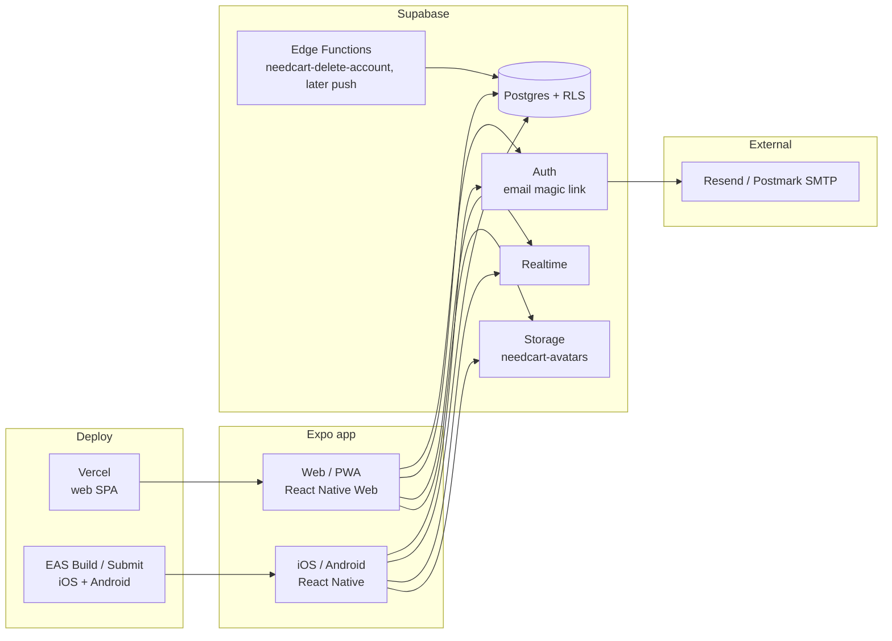
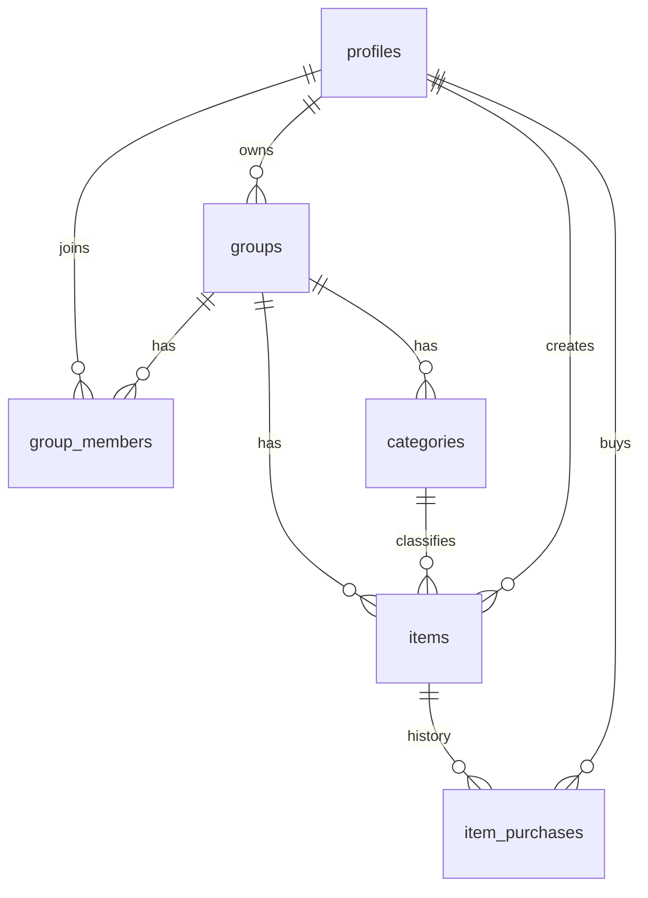

# NeedCart — development plan

- **Status:** implementation in progress — see [STATUS.md](./STATUS.md)
- **Date:** November 17, 2026
- **Updated:** November 19, 2026
- **Progress:** stages 1–5 — functionally complete; stage 6 — partial; stage 7 — in progress (web deployed, native release pending).
- **Product:** NeedCart — a shared shopping list
- **Reference repository:** the current `buyforme` (Quasar/Vue 1 + MongoDB)
- **Future repository:** `needcart` (keep the old one as a reference)

## 0. Name and identifiers

- **Name:** NeedCart
- **Meaning:** need + cart — a shared cart where everything you need goes. One list for a family, a couple, neighbors, or a small team.
- **Repo:** `needcart`
- **App slug:** `needcart`
- **Deep link scheme:** `needcart`
- **Bundle ID:** `com.<company>.needcart`
- **Domain:** `needcart.app`, web app — `app.needcart.app`
- **App Store:** `NeedCart — Shared List`
- **Subtitle:** `One list. One cart.`
- **Tagline:** `One list. One cart. Everyone in sync.`
- **Primary language:** English (`en`), fallback `en`
- **UI languages:** English, Russian, Spanish, German, Portuguese (Brazil), French, Serbian (Latin), Italian
- **Themes:** light, dark, system (default: system)
- **Verification:** DNS for `needcart.app` does not respond right now; check the domain and trademark before buying. I did not find a direct shopping-list app called NeedCart in search; NeedList is a charity service, not a competitor.

---

## 1. Summary

NeedCart is a modern version of Buy For Me: a shared shopping list for a family or a small group. The app runs on iOS, Android, and the web, syncs in real time, and uses Supabase as its backend.

**Chosen stack:**

| Layer | Decision |
|---|---|
| Client | Expo SDK 58+ (React Native), TypeScript, Expo Router |
| Server state | TanStack Query |
| UI | NativeWind + custom components, Reanimated, FlashList |
| Backend | Supabase: Postgres, Auth, Realtime, Storage, Edge Functions |
| Auth | Email magic link only (Google/Apple — post-MVP) |
| Web | Expo Router web, `web.output: "single"`, Vercel |
| Mobile builds | EAS Build / EAS Submit |
| Email | Supabase SMTP + Resend/Postmark |
| Errors | Sentry |
| CI/CD | GitHub Actions + Vercel + EAS |

**Key constraint:** Vercel does not host a native React Native app. Vercel hosts only the web version. iOS/Android are built with EAS and published to the App Store / Google Play.

**MVP scope:** full parity with the original + categories, prices, and budget, a modern UI, realtime, email-only auth, 8 languages (English primary), light/dark/system themes, account deletion.

**Estimated timeline:** ~22–26 working days to MVP accounting for 8 languages and two themes; with a buffer — 5–6 weeks. This is an estimate for one developer; it depends on experience with Expo, Supabase, and setting up auth/stores.

---

## 2. What the original app does

### 2.1 Audit of the current version

The original is a Quasar/Vue 1 SPA on Vercel, with Node.js serverless functions and MongoDB Atlas.

- **Accounts:** name + password or Facebook Login. The password is stored in Mongo in plain text.
- **Groups:** a list of the user's groups, group creation, joining via a 24-character group ID or a Facebook link.
- **Members:** the owner can edit/delete the group and remove members; everyone else adds items and marks purchases.
- **Items:** name, quantity (free text), description, a "purchased" checkbox. The owner can edit/delete entries.
- **Purchase:** when "purchased" is checked, the buyer and date are recorded. When the checkbox is cleared, the user is prompted to re-enter the quantity — "order again".
- **History:** all purchases from the last month are stored; older items keep the last 5. The UI shows the last 5 purchases: who ordered, who bought, quantity, dates.
- **Search and filters:** all / purchased / not purchased, search by name, alphabetical sorting.
- **Design:** RU/EN, customizable colors, a yellow-orange gradient.
- **Admin panel:** access via a secret key, shows users, IP, user-agent, and visit time.

### 2.2 What must be fixed

1. **There is no "real-time" in the original.** The group is refetched every 10 seconds via `setInterval`. The new version uses Supabase Realtime.
2. **Passwords in plain text.** The new version has no passwords: email magic link.
3. **No real access control.** All checks happen on the client and in serverless functions. The new version uses Postgres RLS.
4. **Inconvenient invitation.** A 24-character Mongo ID. The new version uses a short 12-character code, copy support, and a clear join screen.
5. **No offline support or push.** This matters for an app used in a store, but it is not part of the MVP; it is deferred to post-MVP.
6. **The admin panel is a risk.** It does not need to be ported; Supabase Dashboard and logs are enough for support.

---

## 3. Product scope

### 3.1 What is included in the MVP

- Sign-up/sign-in: email magic link (no password).
- Profile: name, avatar, English as the primary language + 7 additional languages, light/dark/system theme.
- Groups: list, creation, joining by code, settings, members.
- Roles: owner, admin, member.
- Items: add, edit, delete (soft delete), quantity, description.
- Categories: group categories, filtering by category, assigning a category to an item.
- Prices and budget: item price, group budget per week/month, planned/spent/remaining.
- Purchases: marking "purchased" with the actual price, history of the last 5 purchases, "order again".
- Search and filters: all / active / purchased, search, category.
- Realtime: changes arrive on all devices without polling.
- Modern UI, light/dark/system themes, web responsiveness.
- Account deletion from the app.
- Web deploy on Vercel, iOS/Android builds via EAS.

### 3.2 What is deferred to post-MVP

- Invitation by code (12 characters); the `/join/CODE` link is a cheap extension, decision pending; QR code — post-MVP.
- Multiple lists in one group ("Groceries", "Pharmacy", "Country house").
- Push notifications.
- Full offline mode with a mutation queue.
- Barcodes, receipt photos, price recognition.
- Spending analytics by category and period.
- Recurring items and list templates.
- Widgets, Apple Watch, export.
- Full purchase history. The MVP keeps all purchases from the last month and the last 5 older purchases per item; older rows are pruned.

### 3.3 Non-goals

- A social network, chat, feed.
- Payments and delivery.
- A public product catalog.
- A complex admin panel.
- SEO optimization of the signed-in area (landing page is separate, if needed).

### 3.4 Roles and permissions

| Action | Owner | Admin | Member |
|---|---:|---:|---:|
| View the group and list | Yes | Yes | Yes |
| Add items | Yes | Yes | Yes |
| Edit any item | Yes | Yes | No |
| Edit own unpurchased item | Yes | Yes | Yes |
| Delete any item (soft delete) | Yes | Yes | No |
| Delete own unpurchased item | Yes | Yes | Yes |
| Mark "purchased" / "order again" | Yes | Yes | Yes |
| Create/edit categories | Yes | Yes | No |
| View the invite code | Yes | Yes | Yes |
| Change the invite code | Yes | Yes | No |
| Invite members | Yes | Yes | Yes |
| Change member roles | Yes | No | No |
| Remove members | Yes | Yes (member only) | No |
| Leave the group | No (only delete the group) | Yes | Yes |
| Change the name, description, budget | Yes | No | No |
| Delete the group | Yes | No | No |
| Transfer ownership | post-MVP | post-MVP | post-MVP |

---

## 4. Screens and user flows

### 4.1 Auth

**Screens:**

- `/sign-in` — value proposition, email field, "Send link". No password and no social buttons.
- `/check-email` — "Check your email", resend timer, "Change email".
- `/auth/callback` — exchanging the code for a session, loading, error handling (expired or already used link).
- `/auth/error` — a clear message and a "Back" button.

**Flows:**

1. The user enters an email → receives the email → follows the universal link → the app opens `/auth/callback` → session.
2. If the link has expired or was already used — an error screen and a resend.
3. After the first sign-in a profile is created (a DB trigger), and if needed — onboarding with name and language.

**Important:** on a phone, a magic link must open the app, not just the browser. This requires universal links (iOS) and App Links (Android). The custom scheme (`needcart://`) is for development/fallback only. More in section 7.

### 4.2 Group list

- Group cards: name, description, member count, active item count, budget progress.
- "Create group" and "Join by code" buttons.
- An empty state with an explanation.
- Pull-to-refresh, a loading skeleton, an offline banner.

### 4.3 Creating a group

Fields:

- Name (required).
- Description (optional).
- Currency (defaults to the device/profile locale).
- Budget (optional) and period: week / month / no budget.
- Group timezone (defaults to the device; can be changed).
- After creation, categories are created automatically: Groceries, Home, Pharmacy, Other (EN) or the localized RU names for the same set.

### 4.4 Joining a group

- Entering the 12-character code, "Paste from clipboard" button.
- Deep link `/join/CODE` — optional, if we enable the invite link (see open decisions); opens the screen with the code pre-filled.
- Clear errors: "Code not found", "You are already in this group".
- After joining — navigate to the group.

### 4.5 Group screen / shopping list

**Header:**

- Name, description, member avatars, role badge.
- Settings button (owner/admin).
- Budget block: "Budget 5,000 ₽ · Spent 2,300 ₽ · Remaining 2,700 ₽", progress bar, "Planned 1,200 ₽".

**List:**

- Search by name/description.
- Filters: all / active / purchased.
- Category chips with colors.
- Items grouped by category; active on top, purchased below (the section collapses).
- Item row: checkbox, name, quantity, price, description, who bought it (avatar), date.
- Swipe actions: edit/delete (if permitted).
- FAB "Add item".

**Adding/editing an item:**

- Name (required).
- Quantity (free text, default "1").
- Category.
- Unit price (optional). The planned line total is unit price × quantity.
- Description (optional).
- Saving with optimistic UI.

**Purchase:**

- Tap the checkbox → "Confirm purchase" bottom sheet.
- Quantity is pre-filled, the unit price is pre-filled from the planned unit price; the sheet shows the resulting line total.
- "Purchased" button → RPC `purchase_item` → haptic → the item moves to purchased → the budget updates.
- Tapping a purchased item again → "Order again": quantity and price, then `reorder_item`.
- History of the last 5 purchases — in the item detail.

### 4.6 Item detail

- Name, current quantity, price, category, description.
- Who ordered and when.
- Who bought and when.
- History of the last 5 purchases: date, quantity, price, orderer, buyer.
- Edit/delete buttons according to permissions.

### 4.7 Group settings

- Name, description, currency, budget, period, timezone (owner).
- Members: avatars, roles, removal/promotion (owner/admin).
- Invite code: show, copy, refresh (owner/admin).
- Categories: add, rename, color, icon, order, delete.
- "Leave group" (admin/member) or "Delete group" (owner).

### 4.8 Profile and settings

- Name, avatar.
- Language: English, Russian, Spanish, German, Portuguese (Brazil), French, Serbian (Latin), Italian. English is primary and the fallback.
- Theme: light / dark / system. Light and dark are mandatory; system is the default mode.
- Accent color (presets).
- Sign out.
- Account deletion (with a warning).
- Privacy policy and terms.

### 4.9 Web

- The same Expo Router code.
- On mobile — bottom tabs; on desktop — a sidebar and content with max-width 720–960 px.
- Modals on the web are dialogs, on native — bottom sheets.
- A PWA manifest and service worker — optional, after the MVP; the main web version is an SPA.

---

## 5. Architecture

### 5.1 Diagram



### 5.2 Why Expo, not Ionic or Next.js

| Criterion | Expo / React Native | Ionic React + Capacitor | Next.js PWA |
|---|---|---|---|
| iOS/Android | Native apps | WebView shell | No |
| Web | Yes, React Native Web | Yes, regular web | Yes |
| Vercel | Web build only | Yes, web/PWA | Yes |
| Native UX | Best | Good | Web |
| Push/camera/haptics | Native | Via plugins | Limited |
| Time to start | Medium | Fast | Fastest |
| PWA complexity | Medium | Low | Low |

**Decision:** Expo, because the app is inherently mobile — it is used in a store on a phone. Ionic would be a reasonable choice if web/PWA and Vercel deployment were the priority, with apps "later". Next.js does not fit because apps in the stores are required.

### 5.3 What replaces the old backend

| Old | New |
|---|---|
| MongoDB | Supabase Postgres |
| Node.js serverless API | PostgREST + RPC + RLS |
| Custom auth | Supabase Auth |
| Polling every 10 seconds | Supabase Realtime |
| Manual permission checks | RLS policies + RPC |
| Mongo `_id` | UUID |
| Passwords in plain text | No passwords: email magic link |
| Facebook SDK | Email magic link |

### 5.4 Data flow

1. The client obtains a Supabase Auth session.
2. It reads data through PostgREST; RLS filters rows by group membership.
3. Critical mutations go through RPC:
   - `create_group`
   - `join_group_by_code`
   - `leave_group`
   - `rotate_invite_code`
   - `purchase_item`
   - `reorder_item`
4. Regular CRUD for items/categories goes through PostgREST with RLS.
5. Realtime subscriptions invalidate the TanStack Query cache.
6. The UI applies optimistic updates and rolls back on error.

### 5.5 Module boundaries

- `features/auth` — session, email magic link, deep links, profile.
- `features/groups` — list, creation, joining, settings, members.
- `features/items` — CRUD, filters, soft delete, realtime.
- `features/purchases` — purchase, reorder, history.
- `features/budget` — currencies, cents, periods, summary.
- `features/categories` — category CRUD, icons/colors.
- `lib/supabase` — client and types.
- `lib/query` — query client, keys, invalidation.
- `theme` — tokens, themes.
- `i18n` — 8 languages, English primary.

### 5.6 Are TanStack Query and SSR needed?

**TanStack Query — yes, but for server state only.**

It is not technically required: you can write your own `useSupabaseQuery` hooks and keep data in Zustand/Context. But for this app, TanStack Query covers exactly the tasks where a hand-rolled layer most often breaks:

- cache for groups, items, members, history, and budget;
- request deduplication and refetch on focus;
- optimistic purchase/reorder/soft-delete updates with rollback;
- cache invalidation on Realtime events;
- pagination/infinite lists, if needed;
- a persisted cache for offline use in post-MVP;
- unified loading/error states.

Zustand then remains only for local UI state (filters, open sheets/dialogs, selected category). There is no need to duplicate server state in Zustand.

If you want to minimize dependencies, you can start without TanStack Query on 2–3 screens, but it pays off once realtime, optimistic purchases, and an offline cache are added. For the MVP I recommend keeping it.

**SSR — no, it is not needed for the MVP.**

This is an authenticated app with user data. SSR gives no SEO benefit for private screens but adds:

- a server runtime on Vercel;
- cookie sessions and a separate Supabase SSR client;
- hydration mismatch and complexity around auth redirects;
- more failure points at deploy time.

The right option for the MVP: Expo Router web in `output: "single"` mode — a regular SPA, static assets, Vercel rewrites to `index.html`. Auth, groups, and lists render on the client after the session is obtained.

SSR/static rendering makes sense only for public pages: landing page, help, privacy policy, terms. They can be built as a separate static site (Astro/Next.js) or as separate static pages, without mixing them into the authenticated SPA.

**PWA is not SSR.** PWA means a manifest, a service worker, an offline cache, and home-screen installation. All of this works with an SPA too. For the MVP, PWA installation is optional; if it becomes important, we will add a manifest + Workbox.

For iOS/Android, SSR makes no sense at all: there it is native React Native.

### 5.7 Why there is no separate backend on Vercel and whether FastAPI is needed

The plan has **no** Node.js/Python API on Vercel. Vercel is only static hosting for the Expo web build. The backend is Supabase:

- Postgres + RLS — data and permissions;
- PostgREST — an automatic REST API;
- SQL RPC — atomic operations;
- Auth, Realtime, Storage;
- Edge Functions — only for service-role tasks (account deletion, push later).

That is why the Vercel Hobby limit on the number of serverless functions/endpoints does not affect us: we do not deploy `api/*.js`. The old setup with a dozen files in `api/` would have hit exactly that limit; the new one does not. The number of SQL functions in Supabase is not the number of Vercel endpoints.

**FastAPI?** Technically possible:

1. A single Vercel Python function `api/index.py` with FastAPI + Mangum — then the function-count limit does not get in the way, because there is one function and any number of routes inside it.
2. A separate FastAPI service on Fly.io/Render/Railway — but that is a second backend.

For this app I do not recommend it:

- Supabase already provides auth, RLS, and realtime; FastAPI would force duplicating authorization or working through the service role and checking permissions manually.
- We would have to solve Postgres connection pooling, JWT verification, CORS, cold starts, deployment, and monitoring for a second service.
- Realtime would still stay in Supabase; the client would talk to two places.
- Python is justified for ML/OCR/complex analytics, but not for shopping-list CRUD.

If Python is needed later (for example, receipt recognition), it is better to add a separate FastAPI service on container hosting and call it from an Edge Function/the client, without replacing Supabase.

**Rule:** SQL RPC in Postgres first; if an external API/secret is needed — a Supabase Edge Function; if Python/ML is needed — a separate service. Vercel is not needed for the backend.

---

## 6. Data model

Full SQL schema: [`docs/schema.sql`](./schema.sql).

**DB schema:** all app objects live in a separate `needcart` schema, not in `public`. This allows using one Supabase database for several projects. The `public` schema is untouched; `needcart` must be added to Exposed schemas, and the client is configured via `db: { schema: 'needcart' }`.

### 6.1 ERD



### 6.2 Tables

#### `profiles`

User profile, linked to `auth.users`.

- `id` — UUID, PK, FK to `auth.users`.
- `display_name`, `avatar_url`.
- `locale` — `en` / `ru` / `es` / `de` / `pt-BR` / `fr` / `sr-Latn` / `it`; default `en`.
- `theme_mode` — `light` / `dark` / `system`; default `system`.
- `accent_color`.
- `created_at`, `updated_at`.

Created automatically by the `handle_new_user()` trigger function.

#### `groups`

Group/household.

- `id`, `name`, `description`.
- `owner_id` — FK to the profile.
- `invite_code` — 12 characters, unique, generated automatically.
- `currency` — ISO 4217.
- `budget_cents`, `budget_period` (`none` / `week` / `month`), `timezone`.
- `created_at`, `updated_at`.

Created only through the `create_group` RPC. There is no direct INSERT into the table.

#### `group_members`

Membership and role.

- `group_id`, `user_id` — composite PK.
- `role` — `owner` / `admin` / `member`.
- `joined_at`.

One owner per group is enforced by a partial unique index. Joining is only through `join_group_by_code`.

#### `categories`

Categories within a group.

- `id`, `group_id`.
- `name`, `color`, `icon`, `sort_order`.
- Uniqueness of `lower(btrim(name))` within a group.

When creating a group, the app passes 4 localized categories to `create_group` (names, colors, icons). The SQL fallback uses English names. Categories are group data; they can be renamed.

#### `items`

An item in the group's list.

- `id`, `group_id`, `category_id`.
- `name`, `quantity` (free text), `description`.
- `price_cents` — **unit price**; the planned line total is unit price × the leading number in `quantity`.
- `is_checked`, `checked_by`, `checked_at`.
- `created_by`, `created_at`.
- `deleted_at` — soft delete.
- `updated_at`.

Price in cents to avoid working with floats. Quantity stays text for parity with the original; its leading number is used as the money multiplier.

#### `item_purchases`

History of completed purchases.

- `item_id` — `ON DELETE SET NULL`, so the financial history is preserved.
- `group_id`, `category_id`.
- Snapshots: `item_name`, `category_name`, `quantity`, `price_cents` (final line total).
- `ordered_by`, `ordered_by_name`, `ordered_at`.
- `purchased_by`, `purchased_by_name`, `purchased_at`.
- `created_at`.

Snapshots make it possible to show history even if an item was renamed, a category was deleted, or a user left the group.

#### `group_overview` (view)

A view for group cards and the budget:

- `member_count`
- `active_items_count`
- `planned_cents` — sum of unit price × quantity for active items.
- `spent_cents` — sum of purchases for the current period.
- `period_start`

`security_invoker = true`, so RLS on the underlying tables applies.

### 6.3 Key data decisions

1. **Money is integer cents.** `price_cents`, `budget_cents`. On the client — formatting via `Intl.NumberFormat`, input — parsing a decimal string into cents.
2. **Price is per unit.** The user enters the unit price; the money multiplier is the leading number in the free-text quantity (for example `2`, `2 l`, `1,5 kg`). Purchase history stores the final line total.
3. **Quantity is free text.** Parity with the original: "2 packs", "300 g", "large".
4. **Soft delete for items.** Allows Realtime to deliver UPDATE to other clients and preserves history. Hard delete is service role only.
5. **History is a separate table with retention.** Not an array inside a document, as in Mongo. Each item keeps all purchases from the last month and at least the last 5 purchases overall; older rows are pruned. The budget window is covered by the last-month retention.
6. **One group — one list.** Multiple lists are deferred to post-MVP to avoid complicating the MVP.
7. **Categories are group data.** Defaults are created when the group is created; the user can add their own.
8. **Budget is per group.** Period: week, month, or no budget. The group timezone is taken into account in the SQL view.
9. **Invitation is a short code.** 12 characters, 60 bits of entropy. Link/QR — post-MVP.
10. **The owner cannot leave.** Only delete the group or transfer ownership (post-MVP).
11. **English is the primary language.** Fallback — `en`; supported: `ru`, `es`, `de`, `pt-BR`, `fr`, `sr-Latn`, `it`. The language is stored in the profile and synced across devices.
12. **Themes — light, dark, system.** Light and dark are mandatory. The theme is stored in the profile; on the web — no flash on load.
13. **Category localization is on the client.** The app passes default category names to `create_group`; SQL does not store translations.

### 6.4 RPC contracts

```ts
// Create group + owner membership + localized default categories
supabase.rpc('create_group', {
  p_name: string,
  p_description?: string | null,
  p_currency?: string,        // 'USD'
  p_budget_cents?: number | null,
  p_budget_period?: 'none' | 'week' | 'month',
  p_timezone?: string,        // 'Europe/Moscow'
  p_categories?: Array<{
    name: string,
    color: string,
    icon: string,
    sort_order?: number,
  }>,
})

// Join by code, returns group_id
supabase.rpc('join_group_by_code', { p_code: string })

// Leave the group; the owner gets an error
supabase.rpc('leave_group', { p_group_id: string })

// Refresh the invite code; owner/admin
supabase.rpc('rotate_invite_code', { p_group_id: string })

// Purchase: atomically writes history and sets is_checked = true
supabase.rpc('purchase_item', {
  p_item_id: string,
  p_price_cents?: number | null,
  p_quantity?: string | null,
})

// Reorder: clears is_checked, preserves history
supabase.rpc('reorder_item', {
  p_item_id: string,
  p_quantity: string,
  p_price_cents?: number | null,
})
```

Regular CRUD:

- `profiles` — select/update self, select the profiles of group-mates.
- `groups` — select own groups, update/delete owner.
- `group_members` — select members; update roles owner; delete owner / admin (member only) / self.
- `categories` — select group members; CRUD owner/admin.
- `items` — select group members; insert — members; update owner/admin or the author of their own unpurchased item; soft delete via update.
- `item_purchases` — select only; writes only through RPC.

### 6.5 Budget calculation

- `planned_cents` = sum of `price_cents × quantity_multiplier(quantity)` for active (`is_checked = false`, `deleted_at is null`) items.
- `spent_cents` = sum of `item_purchases.price_cents` for the current period (week/month) in the group timezone.
- `remaining_cents` = `budget_cents - spent_cents` (computed on the client).
- `projected_cents` = `spent_cents + planned_cents` (a hint for "if everything is bought").
- If no budget is set — we show only the plan.
- If the budget is exceeded — a red progress bar and a clear message.

### 6.6 History logic

**Purchase (`purchase_item`):**

1. Locks the item row `FOR UPDATE`.
2. Checks that the user is a member of the group.
3. If the item is already purchased — returns it (idempotency).
4. Inserts a record into `item_purchases` with snapshots.
5. Sets `is_checked = true`, `checked_by`, `checked_at`, keeps the unit price, and updates the quantity.
6. Everything in one transaction.

**Reorder (`reorder_item`):**

1. Checks membership and locks the item.
2. Sets `is_checked = false`, clears `checked_by`/`checked_at`.
3. Updates the quantity and price.
4. Changes `created_by` to the current user and `created_at` to now.
5. History is not deleted.

**Last 5 purchases:**

```sql
select *
from needcart.item_purchases
where item_id = $1
order by purchased_at desc
limit 5;
```

---

## 7. Auth and security

### 7.1 Providers

- **Email magic link** — the only sign-in method in the MVP. The user enters an email address, receives the email, follows the link; Supabase creates a session.
- **Google / Apple Sign In** — post-MVP. If we add Google, iOS will most likely require Sign in with Apple (see 7.3).

There are no passwords in the system. This removes password storage, password reset, and part of the support burden.

### 7.2 Flows

**Sending the link:**

```ts
const { error } = await supabase.auth.signInWithOtp({
  email,
  options: {
    emailRedirectTo: `${APP_URL}/auth/callback`,
    shouldCreateUser: true,
  },
})
```

**Web:**

1. The user enters an email.
2. Supabase Auth sends the email via SMTP.
3. The link points to `https://app.needcart.app/auth/callback?code=...`.
4. The app exchanges the code for a session (`exchangeCodeForSession`) or accepts tokens from the link — depending on the flow; the SDK stores the session.
5. The session is in `localStorage` (web); the SDK refreshes tokens itself.

**Native:**

1. The user enters an email in the app.
2. Supabase Auth sends the email.
3. The universal link `https://app.needcart.app/auth/callback?code=...` opens the app; if the app is not installed — the web version opens.
4. `exchangeCodeForSession(code)` or `setSession` — depending on the flow.
5. The session is in AsyncStorage (MVP) or SecureStore with chunking (hardening later). The Supabase SDK stores and refreshes the access/refresh tokens.

**Redirect URLs in Supabase Auth:**

- `http://localhost:8081/**`
- `http://localhost:3000/**` (if the web dev server uses port 3000)
- `https://needcart.vercel.app/**`
- `https://app.needcart.app/**` (custom domain, later)
- `needcart://**` (dev)
- `exp://**` (Expo Go, dev only)

If `emailRedirectTo` is not allowlisted, Supabase falls back to the project's **Site URL**. A production Site URL left at `http://localhost:3000` makes deployed magic links point to localhost.

**Why universal links and not just a custom scheme:** `needcart://` links in emails are often not clickable or are blocked by mail clients. An HTTPS link opens the app if it is installed, and the web if it is not. This is critical for the magic link.

**Setup:**

- iOS: `associatedDomains: ["applinks:app.needcart.app"]`, the file `public/.well-known/apple-app-site-association`.
- Android: `intentFilters` with `autoVerify: true`, the file `public/.well-known/assetlinks.json`.
- Vercel must serve `.well-known` with the correct Content-Type and without redirects.
- Testing native auth requires a **development build**, not Expo Go.

**Magic link limitations:**

- Some corporate email scanners open links automatically, and the one-time link may be "burned" before it reaches the user.
- The link is valid for a limited time; resending is required.
- If the link opens in a browser while the app is installed, the universal link must return to the app; otherwise the user ends up in the web version.
- An OTP code (6 digits) is a post-MVP fallback if these problems become noticeable.

### 7.3 App Store and third-party logins

Apple App Review Guideline 4.8 requires a second private login option if the app uses a third-party/social login (Google, Facebook, etc.) for the primary account.

The MVP uses **only email magic link**, that is, its own account system. Therefore **Apple Sign In is not required**.

If we add Google later:

1. Add Sign in with Apple for iOS, or
2. Do not show Google on iOS (email only), or
3. Keep Google only on web/Android.

Until then, auth is simpler: no Google Cloud, OAuth consent, Google SDK, or Apple Sign In.

### 7.4 RLS model

- RLS is enabled on all tables.
- `anon` has no access to app data.
- `authenticated` receives only the necessary grants; RLS filters rows.
- Helper functions `is_group_member`, `is_group_admin`, `is_group_owner`, `shares_group_with` are `SECURITY DEFINER` to avoid RLS recursion.
- All `SECURITY DEFINER` functions have `set search_path = needcart`.
- Critical mutations go only through RPC; direct INSERTs into `groups`, `group_members`, `item_purchases` are forbidden.
- `service_role` is used only in Edge Functions, never in the client.
- Supabase project grants: `revoke all ... from anon, authenticated`, then targeted grants. Policies do not replace grants.

**Checks that are mandatory:**

- A member of group A cannot see group B.
- A member of group A cannot see items of group B.
- A non-member cannot insert an item into someone else's group.
- A member cannot edit someone else's item.
- The owner can edit the group; an admin cannot.
- The owner cannot leave the group.
- `purchase_item` creates exactly one history record and is idempotent.
- `reorder_item` does not create a new purchase and preserves history.
- An item with a category from another group is rejected.
- A profile is visible only to oneself and group-mates.

### 7.5 Account deletion

App Store requirement: if account creation exists, it must be possible to delete the account from the app.

Edge Function `needcart-delete-account`:

1. Verifies the JWT.
2. Finds the groups where the user is the owner.
3. If there are any — returns 409 with the list of groups; the app offers to delete them or transfer ownership (transfer is post-MVP, so in the MVP: delete).
4. Deletes the groups where the user is the owner (if confirmed).
5. Deletes the avatar from Storage.
6. Calls `auth.admin.deleteUser`.
7. Cascades deletion of the profile and memberships.

### 7.6 Other security

- Supabase Auth rate limits + CAPTCHA (Turnstile) on the web.
- Generic sign-in messages so as not to reveal whether an email exists.
- A 60-bit invite code; a generic "Code not found" error.
- Validation of all input on the client (Zod) and in the DB (checks/RPC).
- No secrets in `EXPO_PUBLIC_*`.
- SMTP with SPF/DKIM/DMARC.
- RLS tests in CI.
- Privacy policy, terms, App Store privacy labels.
- Sentry without PII by default.

---

## 8. Realtime

### 8.1 Subscriptions

On the group screen:

```ts
const channel = supabase
  .channel(`group:${groupId}`)
  .on('postgres_changes', {
    event: 'INSERT',
    schema: 'needcart',
    table: 'items',
    filter: `group_id=eq.${groupId}`,
  }, onItemsChanged)
  .on('postgres_changes', {
    event: 'UPDATE',
    schema: 'needcart',
    table: 'items',
    filter: `group_id=eq.${groupId}`,
  }, onItemsChanged)
  .on('postgres_changes', {
    event: 'INSERT',
    schema: 'needcart',
    table: 'item_purchases',
    filter: `group_id=eq.${groupId}`,
  }, onPurchasesChanged)
  .on('postgres_changes', {
    event: '*',
    schema: 'needcart',
    table: 'categories',
    filter: `group_id=eq.${groupId}`,
  }, onCategoriesChanged)
  .on('postgres_changes', {
    event: '*',
    schema: 'needcart',
    table: 'group_members',
    filter: `group_id=eq.${groupId}`,
  }, onMembersChanged)
  .on('postgres_changes', {
    event: 'UPDATE',
    schema: 'needcart',
    table: 'groups',
    filter: `id=eq.${groupId}`,
  }, onGroupChanged)
  .subscribe();
```

- Realtime RLS applies to SELECT/INSERT/UPDATE.
- **DELETE events are not used:** Supabase does not apply RLS to DELETE. Instead:
  - items are soft-deleted → that is an UPDATE, and the event is delivered;
  - deleting a group/member/category → refetch on focus.
- Do not rely on `payload.old`: under RLS it contains only the PK. The fact that an event occurred is enough for invalidation.
- Cache invalidation with a 100–200 ms debounce:
  - items → `['items', groupId]`, `['group-overview', groupId]`
  - item_purchases → `['purchases', groupId]`, `['group-overview', groupId]`
  - categories → `['categories', groupId]`
  - group_members → `['members', groupId]`, `['groups']`
  - groups → `['group', groupId]`, `['groups']`
- Fallback: refetch on focus, pull-to-refresh, periodic refetch when realtime is unavailable.
- `supabase.realtime.setAuth(session.access_token)` when the session is refreshed.
- For a scale of >3000 subscribers — Broadcast instead of Postgres Changes (not our MVP).

### 8.2 Optimistic updates

- Purchase: immediately mark the item as purchased and update the budget; on error, roll back + toast.
- Add/edit: write to the cache immediately; on error, roll back.
- Soft delete: remove from the list immediately; on error, restore.
- `purchase_item` is idempotent, so resending is safe.

---

## 9. Offline

### MVP

- TanStack Query caches data; when there is no network, we show the last cache and a "No connection" banner.
- Reads work from the cache.
- Writes without a network: show an error and ask the user to retry; we do not implement a mutation queue.
- `onlineManager` + `expo-network`.
- Refetch when returning to the app.

### Post-MVP

- `persistQueryClient` + AsyncStorage/MMKV.
- A mutation queue with idempotency keys.
- Client-side UUIDs for create operations so retries do not create duplicates.
- Conflicts: last-write-wins for simple fields; purchase and reorder — via RPC with locking.
- A "syncing" indicator and an action queue.

---

## 10. UI/UX

### 10.1 Visual direction

- Warm minimalism: light background, dark text, an amber accent.
- No heavy gradients like the original; the accent is a color, not a fill for the whole screen.
- Cards with soft shadows/borders, corner radii 16–24.
- Large tap targets, comfortable with one hand.
- The dark theme is fully designed, not an inversion.
- Restrained animations: checkbox, bottom sheet, progress bar; respect `prefers-reduced-motion`.

### 10.2 Tokens

| Token | Light | Dark |
|---|---|---|
| Background | `#FAF7F0` | `#121212` |
| Surface | `#FFFFFF` | `#1E1E1E` |
| Text | `#1F1B16` | `#F5F1E8` |
| Muted | `#7A7166` | `#A8A095` |
| Accent | `#F5B301` | `#FFC83D` |
| Accent contrast | `#3A2A00` | `#2A1D00` |
| Danger | `#D64545` | `#FF6B6B` |
| Success | `#2E7D32` | `#66BB6A` |

- Spacing: 4 / 8 / 12 / 16 / 24 / 32.
- Radius: 12 / 16 / 24 / full.
- Typography: Inter or the system font; headings 24–28, body 15–16, caption 12–13.
- Accent color — presets, stored in the profile.

**Themes:**

- **light** and **dark** are mandatory; **system** is the default mode.
- The theme is stored in `profiles.theme_mode` and synced across devices.
- All screens and states (empty/loading/error/skeleton/toast/sheet) are checked in both themes.
- Native: `useColorScheme`, status bar, navigation theme, keyboard appearance, splash screen.
- Web: `color-scheme`, `<meta name="theme-color">`, the theme from localStorage before the first render so there is no white/black flash.
- Text and icon contrast — at least WCAG AA in both themes.
- App icon and store screenshots — in light/dark variants.

### 10.3 Components

- `GroupCard`, `BudgetBar`, `MemberAvatars`, `CategoryChip`.
- `ItemRow`, `ItemCheckbox`, `ItemSwipeActions`, `ItemForm`.
- `PurchaseSheet`, `ReorderSheet`, `ItemDetailSheet`.
- `EmptyState`, `ErrorState`, `Skeleton`, `OfflineBanner`.
- `ConfirmDialog`, `Toast`.
- `Button`, `Input`, `Select`, `Sheet`, `Avatar`.

### 10.4 Accessibility

- Tap targets ≥44×44.
- Contrast ≥4.5:1 for text.
- `accessibilityLabel`/`accessibilityRole` for checkboxes and icons.
- Dynamic type support; do not fix text height.
- Do not rely on color alone (categories — color + name).
- Focus styles on the web.
- Screen readers: announce "purchased/not purchased", quantity, and price.

### 10.5 i18n

- **Primary language:** English (`en`), fallback — `en`.
- **Supported languages:** English, Russian, Spanish, German, Portuguese (Brazil), French, Serbian (Latin), Italian. Codes: `en`, `ru`, `es`, `de`, `pt-BR`, `fr`, `sr-Latn`, `it`.
- `i18next` + `react-i18next` + `expo-localization`.
- On first launch, the language is taken from the device locale if it is supported; otherwise — English.
- The language is stored in the profile, synced across devices, and switched in settings.
- Pluralization and number/date/currency formatting — via `Intl` with locale awareness. The UI language and the group currency are independent settings.
- Translation files: `src/i18n/locales/en.json`, `ru.json`, `es.json`, `de.json`, `pt-BR.json`, `fr.json`, `sr-Latn.json`, `it.json`.
- Serbian is Latin (`sr-Latn`); Portuguese is Brazilian (`pt-BR`). This is fixed; Cyrillic/European variants can be added later.
- German and Russian texts are longer than English — check wrapping, buttons, and cards on small screens.
- Supabase email templates are not localized per user out of the box. For the MVP — an English template (bilingual EN/RU is possible); full email localization — via a custom auth hook/Edge Function later.
- Translations for 8 languages: an AI draft + native-speaker review for key screens; for ongoing work — Crowdin/Lokalise.

### 10.6 Web responsiveness

- Mobile: bottom tabs, full-width lists.
- Desktop: sidebar, content max-width 960, groups in 2 columns.
- Modals: on native — bottom sheet, on the web — centered dialog.
- Keyboard: Enter/Escape, focus trap in dialogs.
- URL state: filters can be stored in query params (post-MVP).

---

## 11. Project structure

A new repository is recommended. Keep the old `buyforme` as a reference and do not mix Quasar 1 with Expo.

```text
needcart/
  app/                          # Expo Router routes
    _layout.tsx                 # providers, auth guard, splash
    (auth)/
      _layout.tsx
      sign-in.tsx
      check-email.tsx
      auth-error.tsx
    auth/
      callback.tsx
    (app)/
      _layout.tsx               # protected app shell
      (tabs)/
        _layout.tsx
        index.tsx               # groups
        settings.tsx            # profile/settings
      groups/
        new.tsx
        join.tsx
        [id]/
          index.tsx             # group detail / list
          settings.tsx
      items/
        new.tsx                 # modal
        [id].tsx                # detail sheet/page
    +not-found.tsx
  src/
    components/                 # generic UI
    features/
      auth/
        api.ts
        hooks.ts
        AuthProvider.tsx
        deep-links.ts
      groups/
        api.ts
        hooks.ts
        components/
      items/
        api.ts
        hooks.ts
        components/
      purchases/
      budget/
      categories/
    lib/
      supabase.ts
      query-client.ts
      query-keys.ts
      money.ts
      dates.ts
      validation.ts
    theme/
      tokens.ts
      ThemeProvider.tsx
    i18n/
      index.ts
      locales/
        en.json
        ru.json
        es.json
        de.json
        pt-BR.json
        fr.json
        sr-Latn.json
        it.json
    types/
      database.ts               # supabase gen types
  supabase/
    migrations/
    functions/
      needcart-delete-account/
    seed.sql
    config.toml
  public/
    .well-known/
      apple-app-site-association
      assetlinks.json
    manifest.json
  assets/
  docs/
  app.json
  eas.json
  vercel.json
  package.json
  tsconfig.json
```

Principles:

- A feature = API + hooks + components; do not scatter requests across screens.
- All Supabase queries live in the feature's `api.ts`.
- All query keys live in one place.
- DB types are generated from Supabase, not written by hand.
- Screens stay thin; business logic lives in hooks/RPC.

---

## 12. Environments and deploy

### 12.1 Environments

| Environment | Supabase | Web | Mobile |
|---|---|---|---|
| Local | Supabase CLI + Docker + Inbucket | Expo dev server | Expo dev build |
| Staging | Separate Supabase project | Vercel Preview | EAS preview build |
| Production | Supabase Pro project | Vercel Production | EAS production build |

Do not use the production DB for development. Staging is needed to verify auth, realtime, and RLS before release.

### 12.2 Supabase

1. Create staging/production projects, with the region closest to users (for example, Frankfurt for the EU).
2. `supabase init`, `supabase link`, migrations in `supabase/migrations`.
3. Apply `docs/schema.sql` as the first migration after review (it creates the `needcart` schema; `public` is untouched).
4. Add `needcart` to Exposed schemas, enable RLS, and verify grants.
5. Configure Auth:
   - Email magic link, email template (English; bilingual EN/RU optional).
   - Site URL and redirect URLs.
   - Custom SMTP (Resend/Postmark) + SPF/DKIM/DMARC.
   - CAPTCHA (Turnstile) for the web.
   - Google/Apple providers — post-MVP; not configured now.
   - Email OTP fallback — post-MVP, if the magic link opens poorly.
6. Create the `needcart-avatars` bucket, policies.
7. Add the tables to the `supabase_realtime` publication.
8. Generate types: `supabase gen types typescript --project-id ... --schema needcart > src/types/database.ts`.
9. Configure backups (Pro) and logs.

**Important:** on new Supabase projects, the `anon`/`authenticated` roles may have broad grants by default. The schema explicitly does `revoke all` and targeted grants — do not skip this step.

### 12.3 Vercel

Expo SDK 58+ uses `web.output: "server"` by default. For a simple SPA on Vercel we explicitly set:

```json
{
  "expo": {
    "web": {
      "bundler": "metro",
      "output": "single"
    }
  }
}
```

`vercel.json`:

```json
{
  "buildCommand": "npm run export:web",
  "outputDirectory": "dist",
  "devCommand": "npx expo start --web",
  "framework": null,
  "rewrites": [
    { "source": "/:path*", "destination": "/" }
  ]
}
```

Vercel variables:

- `EXPO_PUBLIC_SUPABASE_URL`
- `EXPO_PUBLIC_SUPABASE_ANON_KEY`

`EXPO_PUBLIC_APP_URL` is optional and not needed for the web build: on web the app uses `window.location.origin`. Set it for native EAS builds when a stable production URL exists.

`SUPABASE_SERVICE_ROLE_KEY` is not needed in Vercel and must not end up there.

The first deployment uses `https://needcart.vercel.app`; `app.needcart.app` is the planned custom domain. Configure the deployed URL in Supabase Auth Site URL and Redirect URLs. OAuth providers are not needed in the MVP.

For universal links, the files `public/.well-known/apple-app-site-association` and `public/.well-known/assetlinks.json` must be served with `Content-Type: application/json` and without redirects. Add headers in `vercel.json` and verify that the SPA rewrite does not intercept `.well-known`:

```bash
curl -I https://app.needcart.app/.well-known/apple-app-site-association
curl -I https://app.needcart.app/.well-known/assetlinks.json
```

PWA:

- `public/manifest.json`, icons, theme-color.
- Service worker (Workbox) — post-MVP; without it the web works as an SPA.
- If PWA becomes a priority, a separate Next.js/Ionic client may be simpler; for the MVP Expo web is enough.

### 12.4 iOS/Android

- `eas.json` with `development`, `preview`, `production` profiles.
- Bundle ID / package: `com.<company>.needcart`.
- Icons, splash, app store screenshots — in light and dark variants; for iOS 18 — a dark/tinted icon, for Android — a monochrome/themed icon.
- `associatedDomains` and `intentFilters` for universal links.
- `expo-dev-client` for testing the magic link and universal links.
- EAS Build → TestFlight / internal testing → EAS Submit.
- Apple Developer ($99/year), Google Play ($25 one-time).
- Privacy policy URL, support URL, account deletion.
- App Store privacy labels: email, name, user content (shopping list), diagnostics.
- Store listing: English is primary; Russian is the minimum; other languages as feasible. Screenshots at least EN/RU, light/dark.
- Review notes: a demo account or test data, an explanation of the group functionality.

### 12.5 CI/CD

GitHub Actions:

- `npm ci`
- `npm run lint`
- `npm run typecheck` (`tsc --noEmit`)
- `npm test`
- `npx expo-doctor`
- `supabase db lint` / `supabase test db` (if configured)
- Vercel Preview on PRs.
- EAS preview build on main or by tag (can be manual at the start).

Production:

- Merge into `main` → Vercel production.
- Tag `v*` → EAS production build + submit (confirm manually).

### 12.6 Environment variables

| Variable | Where | Public |
|---|---|---|
| `EXPO_PUBLIC_SUPABASE_URL` | client, Vercel, EAS | Yes |
| `EXPO_PUBLIC_SUPABASE_ANON_KEY` | client, Vercel, EAS | Yes |
| `EXPO_PUBLIC_APP_URL` | client (native), EAS; optional on web | Yes |
| `SUPABASE_SERVICE_ROLE_KEY` | Edge Functions | No |
| `RESEND_API_KEY` | Supabase SMTP / Edge Functions | No |
| `SENTRY_AUTH_TOKEN` | CI | No |
| `EXPO_ACCESS_TOKEN` | CI/EAS, later push | No |

### 12.7 Cost (approximate)

- Supabase Free — development; Pro ~$25/month for production (no pauses, backups).
- Vercel Hobby — a personal project; Pro ~$20/month if commercial.
- EAS — there is a free tier; Production/Enterprise are paid, check the current pricing.
- Apple Developer — $99/year.
- Google Play — $25 one-time.
- Domain — $10–20/year.
- Resend/Postmark — a free tier for a start, then volume-based.
- Sentry — free tier.

Prices change; verify current ones before starting.

---

## 13. Testing and QA

### 13.1 Levels

- **Unit:** money utils (cents/formatting), budget period, filters, sorting, Zod schemas.
- **Component:** ItemRow, BudgetBar, ItemForm, PurchaseSheet, GroupCard.
- **SQL/RLS:** pgTAP or SQL scripts in local Supabase.
- **E2E:** Maestro for the main flows.
- **Manual:** iOS/Android/web, light/dark/system, 8 languages, offline, slow network.

### 13.2 Mandatory test cases

**Auth:**

- Magic link on web, iOS, Android (universal link/App Link).
- The link opens the app if it is installed; otherwise the web version.
- An expired/reused link; resending.
- A link opened by an email scanner does not create a second session; the user sees a clear error and can request a new one.
- A new user is created, the profile appears automatically.
- An existing user signs in to the same account.
- A wrong email, rate limit, a generic message without revealing that the account exists.
- Sign out and sign in again; account deletion.

**Groups:**

- Creating a group → default categories appear.
- Joining by code; a wrong code; joining again.
- The owner changes the name/budget.
- An admin promotes/demotes a member.
- The owner cannot leave.
- Deleting the group by the owner.

**Items:**

- Add/edit/delete.
- A member can edit only their own unpurchased item.
- A member cannot edit someone else's/purchased item.
- A soft delete disappears for all members via realtime.
- A category from another group is rejected.

**Purchases:**

- A purchase creates one history record.
- A repeated purchase is idempotent.
- Reorder clears the checkbox, history is preserved.
- The last 5 purchases are sorted correctly.
- The budget is recalculated.

**RLS:**

- A non-member cannot see the group/items.
- A non-member cannot insert an item.
- A profile is visible only to group-mates.
- `anon` has no access.

**Realtime:**

- Two devices: add/purchase/delete arrives without polling.
- Connection loss → reconnect → refetch.
- Member removal → access disappears after refetch.

**Languages:**

- Switching all 8 languages in settings; the choice persists after restart and syncs across devices.
- First launch: a device on a supported language → that language; on an unsupported one → English.
- Default categories when creating a group — in the selected language.
- Long strings (DE/RU) do not break buttons, tabs, and cards.
- Numbers, dates, and currency are formatted by locale; the UI language does not change the group currency.
- Serbian (`sr-Latn`) and Brazilian Portuguese (`pt-BR`) are displayed correctly.

**Themes:**

- Light, dark, and system switch without a restart.
- All screens, empty/loading/error, bottom sheets, toasts, and forms are readable in both themes.
- Web: no flash of the wrong theme on load; `theme-color` and `color-scheme` are correct.
- Native: the status bar, keyboard, splash, and navigation theme match the theme.
- Text and icon contrast pass the check in both themes.

### 13.3 E2E

- Maestro flows: sign-in (test session), create a group, add an item, purchase, reorder, filter, budget.
- For the magic link locally — Supabase Inbucket (Mailpit) on `localhost:54324`.
- For CI — create a test user via the Admin API and use a session/invite link; test the magic link itself manually on staging.
- Test data — seed.sql: two groups, two users, items, history.

### 13.4 Definition of Done for the MVP

- All mandatory test cases pass.
- RLS tests in CI.
- No errors in Sentry on staging for 48 hours.
- Web is available on Vercel, iOS/Android — in TestFlight/internal testing.
- The magic link works on real devices (web, iOS, Android).
- Account deletion works.
- All 8 languages and light/dark/system are verified on iOS/Android/web.
- Privacy policy and store metadata are ready.
- List load time <2 s on an average connection; realtime latency <1 s.

---

## 14. Observability

- **Sentry** for Expo (iOS/Android/web), source maps, release tracking.
- Error boundary at the app and group level.
- Supabase logs: auth, Postgres, Edge Functions.
- Vercel logs/analytics.
- EAS build logs.
- Metrics: DAU, groups created, items, purchases, auth errors, realtime reconnects.
- Analytics — post-MVP; if added, PostHog/Umami with consent.
- Logs must not contain emails/tokens/list contents.

---

## 15. Phased plan

| Stage | Duration | Outcome | Done criterion | Status |
|---|---:|---|---|---|
| 0. Decisions and accounts | 1 day | Confirmed email-only auth, domain, NeedCart brand, currencies, languages; Supabase/Vercel/EAS created | Access, redirect URLs, and a test project exist | 🟡 brand/auth/currencies/languages decided; Vercel project exists; domain, EAS, and trademark — not yet |
| 1. Skeleton | 2 days | New Expo project, TS, Expo Router, themes, i18n skeleton, CI, base components | The app runs on iOS/Android/web, lint/typecheck green | 🟡 web build and checks are green; the native build has not been run yet |
| 2. DB and auth | 3 days | Migrations, RLS, RPC, profiles, email magic link, protected routes | Sign-in works on web and native; RLS tests pass | 🟡 schema/RLS/RPC/auth are ready; pgTAP in CI and the native magic link are not verified |
| 3. Groups | 2 days | List, creation, joining by code, settings, members | Two users see one group; roles work | ✅ implemented and verified via API/DB |
| 4. Items and categories | 3 days | CRUD, categories, search/filters, soft delete, realtime, optimistic UI | Changes arrive on the second device in <1 s | 🟡 implemented; two-device realtime QA is not recorded |
| 5. Purchases and budget | 3 days | Purchase/reorder/history, budget, currency, periods, view | History and budget are computed correctly; tests | ✅ DB smoke and API E2E passed |
| 6. Localization and themes | 3 days | 8 languages, light/dark/system, empty/loading/error, accessibility, web adaptivity | All screens are verified in both themes and all languages; no truncated text | 🟡 8 languages and themes exist; 6 translations are drafts, no accessibility audit |
| 7. Release | 5 days | Universal links, account deletion, EAS builds, Vercel, store assets light/dark | TestFlight/internal testing + production web | 🟡 account deletion, icon, and Vercel deploy are ready; EAS/universal links/store metadata/auth redirects — not yet |

**Total:** ~22–26 working days. A 20–30% buffer → 5–6 weeks. Translations into 8 languages can run in parallel, but native-speaker review adds time.

A detailed checklist with files and remaining tasks: [STATUS.md](./STATUS.md).

**Demo after stage 5:** a full product can already be shown on the web and in a dev build. Stages 6–7 are polish and release.

---

## 16. Risks and mitigations

| Risk | Probability | Impact | Mitigation |
|---|---|---|---|
| Apple 4.8 when adding Google | Low (post-MVP) | A future iOS blocker | Email-only in the MVP; if Google is added — Apple Sign In |
| Magic link does not open the app | Medium | Auth blocker | Universal links + tests in Gmail/Outlook/Apple Mail; OTP fallback post-MVP |
| Poor email deliverability | Medium | Auth blocker | Custom SMTP, SPF/DKIM/DMARC, bounce monitoring |
| Google OAuth on native | Post-MVP | Delay when adding | Supabase `signInWithOAuth`, dev build, tests on iOS/Android |
| Realtime DELETE does not respect RLS | Medium | Stale data | Soft delete for items, refetch on focus, do not use DELETE |
| An RLS mistake exposes data | Low | Critical | RLS tests, revoke/grant, code review, staging |
| The budget "drifts" due to floats | Medium | Incorrect amounts | Integer cents only |
| Timezones | Medium | Wrong period | Group timezone + SQL view |
| Store review | Medium | Release delay | Account deletion, privacy policy, demo account, screenshots |
| Supabase Free pauses | Medium | Downtime | Pro for production |
| Vercel is confused with RN hosting | High | Misunderstanding | Vercel = web; EAS = mobile |
| Old data is not migrated | High | Loss of users | A deliberate clean start; a migration script by email if needed |
| Offline expectations | Medium | Dissatisfaction | State it explicitly in the MVP; post-MVP queue |
| PWA on Expo requires manual setup | Medium | Web installation | PWA post-MVP; the web works as an SPA |
| 8 languages increase the QA scope | High | Timeline/quality | AI draft + native-speaker review; screenshots and pseudolocalization |
| Long DE/RU strings break the UI | Medium | Poor UX | Testing on small screens; flexible buttons/wrapping |
| Theme flash on the web | Medium | Poor first paint | Theme from localStorage before render, `color-scheme`, meta theme-color |
| Quality of sr-Latn/pt-BR translations | Medium | Incorrect locale | Native-speaker review; a terminology glossary |
| Scope grows | High | Timeline | Lock the MVP; everything else goes to the backlog |

---

## 17. Migration from the old app

### Recommendation: a clean start

Reasons:

- Passwords are stored in plain text in Mongo — they cannot be migrated securely.
- Some users have no email (Facebook login), and the magic link requires an email.
- The old IDs are Mongo ObjectIDs; the new schema uses UUID.
- The old history is an array inside an item; the new one is a table.

Users simply sign up again via email. That is fine for a 2020 project.

### If migration is still needed

A one-off script (Node/TS) with the service role:

1. Export `users`, `groups`, `items` from Mongo.
2. Match users by email; create auth users via the Admin API (invite/magic link).
3. Users without email — skip them or create stub profiles without sign-in.
4. Create groups, owner membership, default categories.
5. Migrate items; `checked` → `is_checked`, `created` → `created_at`.
6. `history[]` → `item_purchases` rows; prices are missing → null.
7. Keep a mapping of old IDs → new UUIDs.
8. Run it on staging, verify RLS and the totals.

This is a separate 1–2 day project; it is not part of the MVP unless decided otherwise.

---

## 18. Open decisions

To be confirmed before starting:

**Already decided:** NeedCart, the `needcart` repository, English primary, Serbian Latin (`sr-Latn`), Brazilian Portuguese (`pt-BR`), light/dark/system themes with system as the default, auth — email magic link only.

1. **Third-party logins.** Google/Apple — post-MVP. Do we add them after release?
2. **Invitation by link/QR.** The code is already in the MVP. The link is a small extension; QR is a bit more work. Include them?
3. **Multiple lists in a group.** Currently post-MVP. Definitely not needed in the first version?
4. **Push and offline.** Currently post-MVP. Agreed?
5. **Domain and trademark.** Check and buy `needcart.app`; check the NeedCart trademark.
6. **Default currency.** EUR/USD/RUB? Or take it from the device locale?
7. **Price per line or per unit.** The plan says per whole line. Is that acceptable?
8. **Account deletion with groups.** Delete the groups where the user is the owner after confirmation? Or block deletion until ownership is transferred?
9. **Migration of old data.** Is it needed, or is a clean start fine?
10. **Supabase region.** Frankfurt? Another one?
11. **Vercel Hobby or Pro.** If the project is commercial/with ads — Pro.
12. **App Store localization.** English + Russian only, or all 8 languages?

---

## 19. Next steps

1. Confirm the domain and the remaining decisions.
2. Create the Supabase staging/production, Vercel, and EAS projects.
3. Buy/configure the `needcart.app` domain, add redirect URLs.
4. Create the new `needcart` repository and the Expo skeleton.
5. Apply the schema locally, run the RLS tests.
6. Build the vertical slice: auth → groups → items → purchase → budget.
7. Wire up realtime and optimistic updates.
8. Set up universal links and the email magic link.
9. Add 8 languages and light/dark/system tokens.
10. Build for TestFlight/internal testing, deploy the web.
11. Pass store review.

---

## Appendix A. Example client calls

### Group list

```ts
const { data, error } = await supabase
  .from('group_overview')
  .select('*')
  .order('created_at', { ascending: false });
```

### Group items

```ts
const { data, error } = await supabase
  .from('items')
  .select(`
    *,
    category:categories(id, name, color, icon)
  `)
  .eq('group_id', groupId)
  .is('deleted_at', null)
  .order('is_checked', { ascending: true })
  .order('name', { ascending: true });
```

### Purchase

```ts
const { data: item, error } = await supabase.rpc('purchase_item', {
  p_item_id: itemId,
  p_price_cents: actualPriceCents,
  p_quantity: quantity,
});
```

### Reorder

```ts
const { data: item, error } = await supabase.rpc('reorder_item', {
  p_item_id: itemId,
  p_quantity: nextQuantity,
  p_price_cents: nextPriceCents,
});
```

### Last 5 purchases

```ts
const { data, error } = await supabase
  .from('item_purchases')
  .select('*')
  .eq('item_id', itemId)
  .order('purchased_at', { ascending: false })
  .limit(5);
```

---

## Appendix B. Useful links

- Supabase Auth + Expo: https://supabase.com/docs/guides/auth/quickstarts/with-expo-react-native-social-sign-in
- Supabase Email Auth: https://supabase.com/docs/guides/auth/auth-email
- Supabase Native Deep Linking: https://supabase.com/docs/guides/auth/native-mobile-deep-linking
- Supabase Realtime Postgres Changes: https://supabase.com/docs/guides/realtime/postgres-changes
- Supabase RLS: https://supabase.com/docs/guides/database/postgres/row-level-security
- Expo Router web publishing: https://docs.expo.dev/guides/publishing-websites/
- Expo deep linking: https://docs.expo.dev/guides/deep-linking/
- Expo authentication: https://docs.expo.dev/develop/authentication
- Apple App Review Guidelines 4.8: https://developer.apple.com/app-store/review/guidelines/#login-services
